# Same weight, different loss

**The weak-form discretization sets the effective initial-condition weight in physics-informed training**

Ayush Gouda · Swaraag Hebbar N · Aditya Prakash · Sudheendra B S
RV Institute of Technology and Management (RVITM), Bengaluru

<p align="center">
  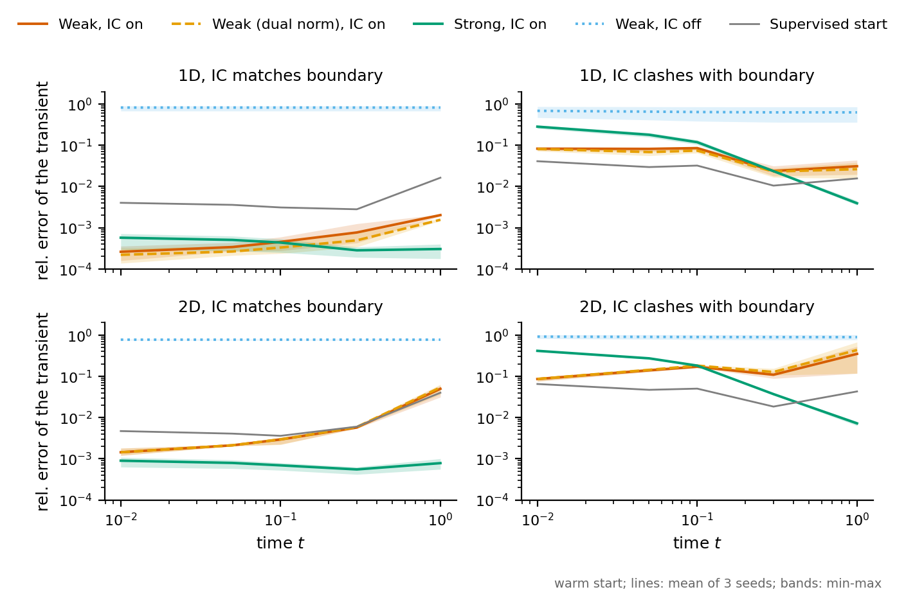
</p>
<p align="center"><em>Warm-start test on the heat equation. Left: with a matching initial condition (IC) nothing drifts. Right: when the IC clashes with the hard boundary, the strong loss (green) fails <strong>early</strong> in the transient and the weak loss (orange) fails <strong>late</strong>. Grey is the supervised starting point.</em></p>

---

## The idea in one minute

Many physics-informed models build the Dirichlet boundary into the network, `u = 1 + B(x)·NN(x,t)`, and leave the initial condition to the loss as a penalty. That works until the two disagree. A plate at temperature 0 whose edge is suddenly held at 1 gives `u(x,0) = 0` in the interior and `u = 1` on the boundary. No smooth, boundary-pinned network can represent that jump, so the IC penalty and the physics residual **cannot both be made small**, and the penalty keeps pulling.

What we find:

- **Both losses drift away from the exact solution, at opposite ends of the transient.** Take a network fitted to the exact solution by supervision and train it on the physics loss alone. The strong-form loss goes wrong early and recovers. The weak-form (variational) loss goes wrong late.
- **Where it fails is set by the *effective* weight of the IC penalty.** The same nominal weight acts **10³ to 10⁵ times more strongly** in the weak loss. We call that factor **κ**.
- **κ has a closed form on fine meshes:** κ ≈ (test functions per element) × N^(2d), with N elements per dimension in d dimensions. Weight sweeps and changes of mesh and test-function order move each loss's failure as κ predicts, on heat and on advection–diffusion.
- **The training loss does not warn you.** In 2D weak-form training both loss terms fall while the error at t = 1 grows eightfold (0.040 → 0.320).
- **Loss weights do not transfer** between loss forms or between meshes. Normalizing the weak residual by element measure removes the mesh dependence.

## Headline numbers

| | |
|---|---|
| κ, 1D heat (16 elements, p = 6) | **2,200** measured vs 1,792 predicted by the lemma |
| κ, 2D heat (8 × 8, p = 4) | **2.2 × 10⁵** measured vs 1.02 × 10⁵ predicted |
| κ, advection–diffusion (same mesh as 1D heat) | 2,000 (the ratio belongs to the loss discretization, not the equation) |
| Weak loss, 2D, error at t = 1 during training | 0.040 → 0.320 while the weak residual falls 6.6 × 10⁻⁵ → 3.9 × 10⁻⁵ |
| Strong loss, 2D, error at t = 0.01 vs t = 1 | 0.42 → 0.007 (wrong early, fine late) |
| Weak loss, 2D, error at t = 0.01 vs t = 1 | 0.084 → 0.32 (fine early, wrong late) |
| Normalized weak loss, κ on 4 → 32 elements | 30, 20, 8.6, 6.9, approaching the lemma's n_test = 7 |
| Cost per step (A100, fp64) | weak is 1.6× cheaper in 1D and 2.1× cheaper in 2D than strong |
| Cost of measuring κ | 3 to 4 s per seed, about 2% of a warm weak-form run |

---

## Results, with the figures

### 1. A falling loss is no evidence of progress

The waterfall shows each form's own objective from the supervised start to the end of training. In the weak-form rows, both the IC and physics terms go down. The model it ends up at is nonetheless the one with the larger error. The strong form instead buys back almost all of its physics residual (47.5 → 0.53 in 1D) at the cost of the IC term.

<p align="center">
  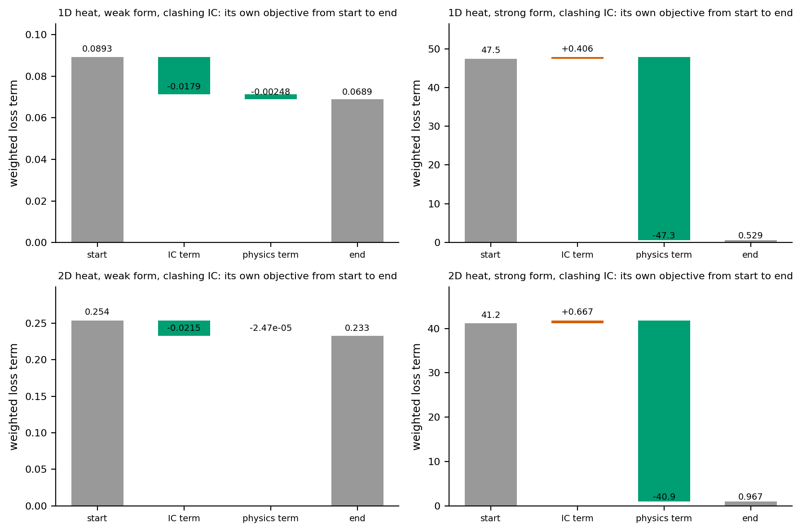
</p>

### 2. Why: the IC pull against the physics pull

The IC gradient is identical in both losses. The physics gradient is not. On the right, the weak physics gradient shrinks as the elements shrink while the strong one stays put. That shrinkage is κ.

<p align="center">
  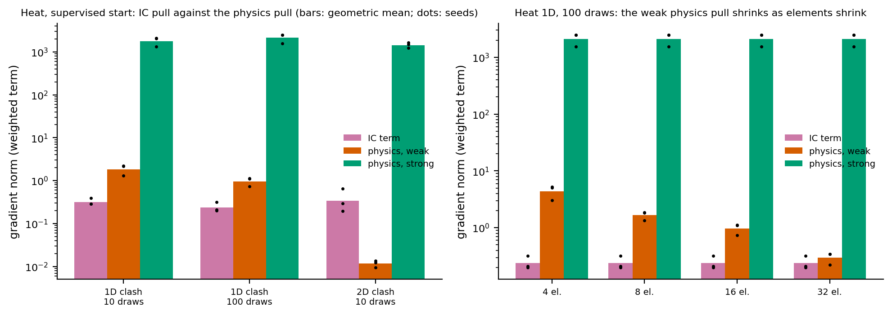
</p>

### 3. κ follows the discretization

Measured κ against element width (left, slope ≈ −1.23 on log–log) and test-function order (right). On 16 elements κ is 1.21 to 1.25 times 256·(p+1) for every order. The lemma's assumption is that the residual is smooth on the element scale, and the paper gives a measured criterion for when that holds.

<p align="center">
  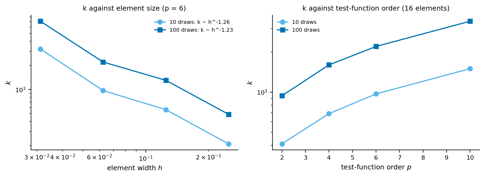
</p>

### 4. Moving the weight moves the failure

Raise the strong form's IC weight and its error moves from early to late. Lower the weak form's and it does the reverse. In 1D the two sweeps trace **one curve** once the weak runs are placed at multiplier × κ. The dashed line is κ.

<p align="center">
  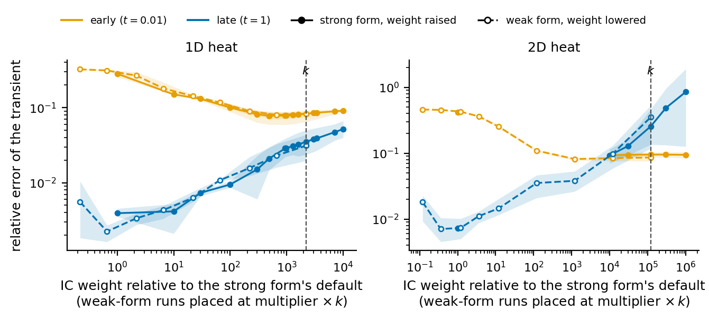
</p>

The cleanest test is where the gap between the two forms is smallest, and whether that lands where the independently measured κ says. In 1D it lands at 0.004 for the strong form at 2,200 times its default.

<p align="center">
  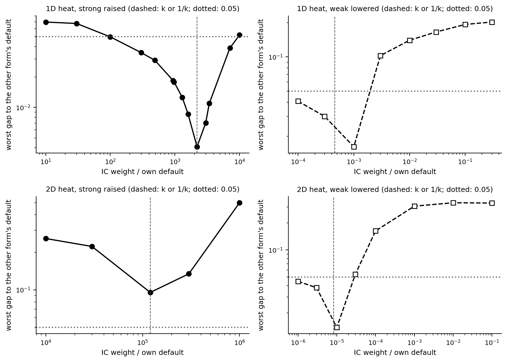
</p>

A Gaussian-process fit to each sweep puts the minimum between about 0.7 and 2.3 times κ in all six sweeps (1D and 2D heat, advection–diffusion, each in both directions):

<p align="center">
  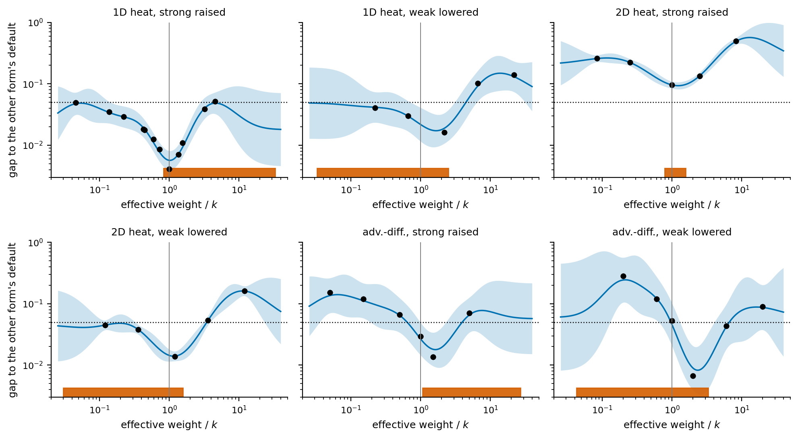
</p>

### 5. A second equation

Advection–diffusion with the same network, losses and trial space. The defaults split the same way (strong worse early, weak worse late), and the forms meet near the measured κ.

<p align="center">
  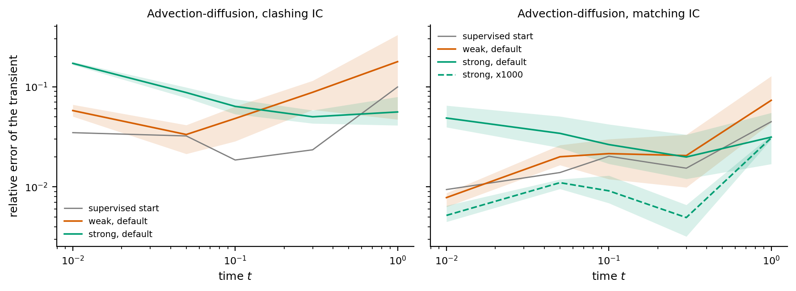
</p>

---

<details>
<summary><b>More figures</b> (cold starts, annealing, seed spread, advection–diffusion sweeps)</summary>

<br>

**All eight default arms**: 1D/2D × matching/clashing × warm/cold start.

<p align="center">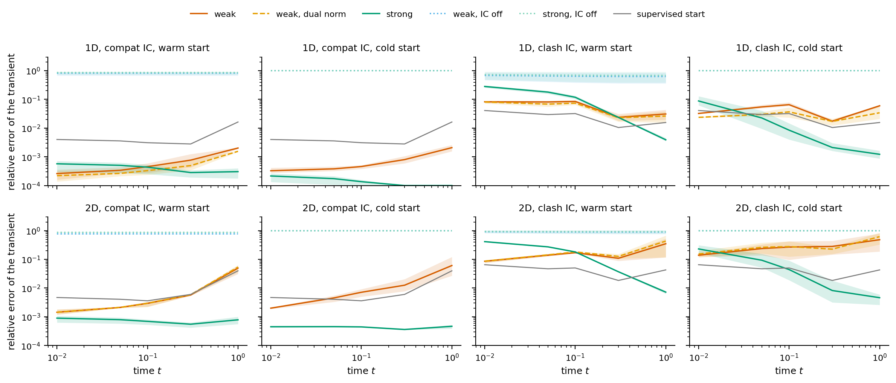</p>

**Learning-rate annealing** [Wang et al.] resets the IC weight during training. It sets large weights every time (10⁴ to 10⁷ times the default for the strong form) and moves the failure rather than removing it.

<p align="center">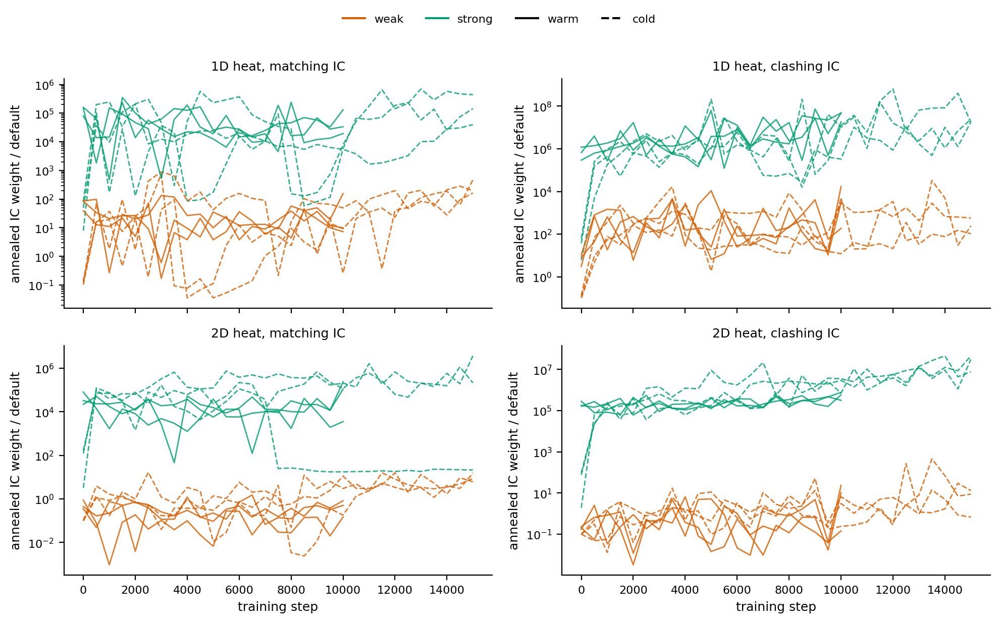</p>

**Seed spread.** Late-time 2D weak-form errors vary a lot between seeds (0.081 to 0.72 at t = 1 over ten seeds), so those arms use ten seeds instead of three. Bars show the seed range and the standard error of a three-seed mean against the 0.05 match threshold.

<p align="center">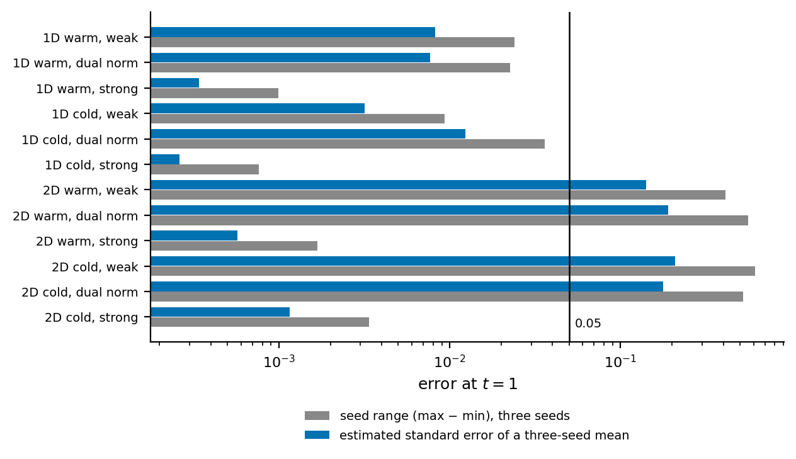</p>

**Mesh, order and normalization**: weak default against strong at κ, for every setting.

<p align="center">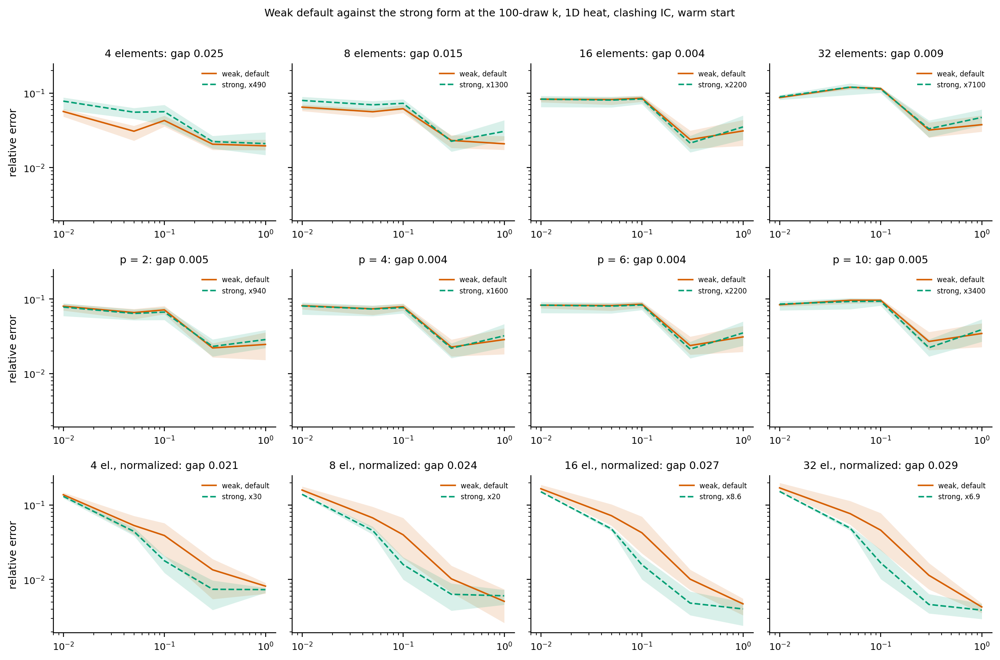</p>

**Advection–diffusion sweep and diagnostics.**

<p align="center">
  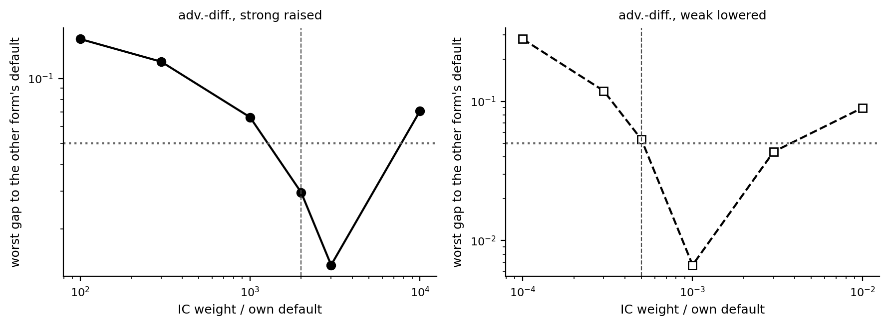
  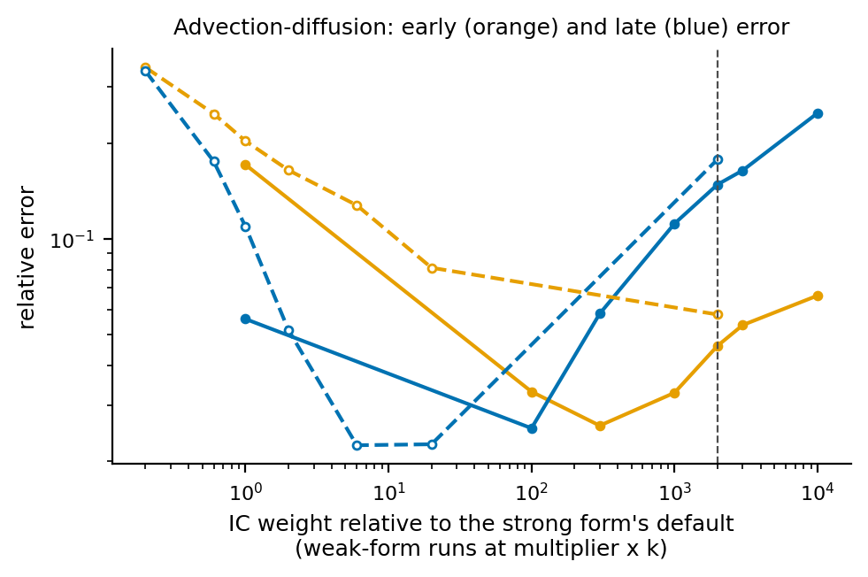
</p>
<p align="center">
  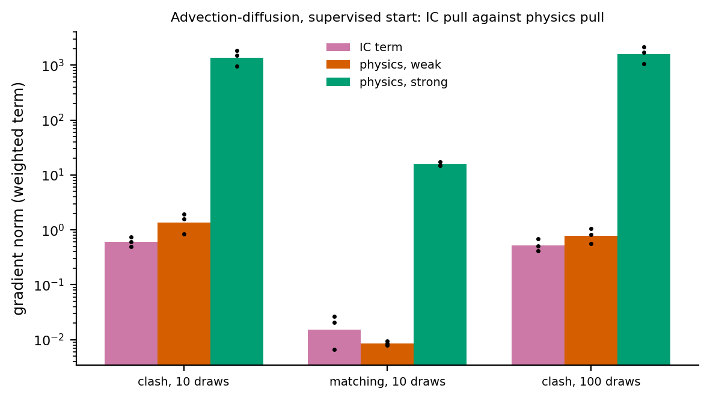
  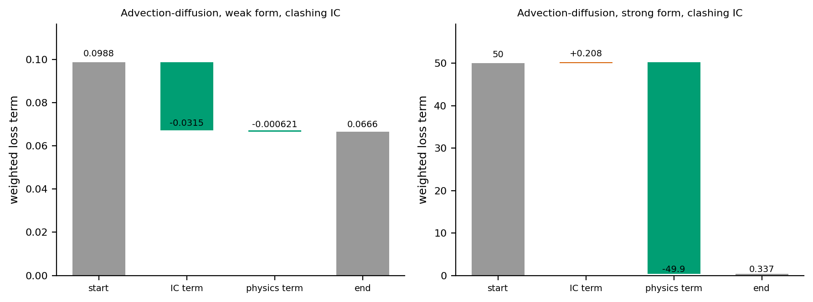
</p>

Every figure also exists as a vector PDF next to its PNG, and the heat sweep heatmap, per-seed boxplots, absolute-error and masked-IC-band plots are in [`heat_runs/heat_figs/`](heat_runs/heat_figs/).

</details>

---

## What's in the repo

```
heat_drift.py           models, losses, exact solutions, training, κ measurement; every experiment is a mode of this script
run.sh                  batch driver: weak-sweep gaps, annealing, 2D strong sweep, as one pool (GPU recommended)
run_final.py            normalization, test-function order, advection–diffusion (stages A, B, C)
run_mesh.py             weak-form mesh study (4/8/32 elements)
cn_baseline.py          classical Crank–Nicolson / Rannacher baseline (CPU, no training)
linear_model_check.py   Proposition 1 check on a model that is linear in its parameters (CPU, no training)
anneal_weights.py       prints where the annealed IC weight ended up, per run
make_figs.py            figures, tables and per_seed.csv from the stored JSON (CPU, no torch)
pull_heat_tables.py     the appendix .tex tables from the stored JSON
pull_paper_values.py    prints the numbers the text quotes and writes appendix tables (see notes below)
heat_runs/              one folder per experiment (ckpt/, logs/, results/), plus heat_figs/, advdiff_figs/, cn_baseline/, linear_check/
results/                generated figures, tables and per_seed.csv
DigTwin (11).pdf        the paper
```

Run everything from the repo root.

## Reproducing

```bash
pip install -r requirements.txt
python heat_drift.py --all --jobs 8          # main arms (see the usage block at the top of heat_drift.py for the other modes)
python heat_drift.py --summary               # table from finished runs
python cn_baseline.py                        # classical baseline
python linear_model_check.py                 # linear-model check of Proposition 1
python make_figs.py                          # figures + tables from the stored JSON
python pull_heat_tables.py                   # appendix tables
```

The stored JSON under `heat_runs/*/results/` is enough to regenerate every figure and table **without retraining**. Finished runs are skipped on restart, so every driver is safe to interrupt.

| To reproduce | Run |
|---|---|
| Warm-start test, both losses, 1D and 2D | `python heat_drift.py --all --jobs 8` |
| Measure κ at the supervised fits | `python heat_drift.py --measure --dims 1 2 --out heat_runs/heat_matched --starts DIR` |
| Weight sweeps, annealing, 2D strong sweep | `bash run.sh` (A100-class GPU; `JOBS=30 bash run.sh` to change the pool size) |
| Mesh study | `python run_mesh.py` (CPU is fine) |
| Normalization, test-function order, advection–diffusion | `python run_final.py` (1D only, a T4 works) |
| Classical Crank–Nicolson / Rannacher baseline | `python cn_baseline.py` |
| Proposition 1 on a linear model | `python linear_model_check.py` |

**Setup used in the paper:** double precision, Adam only, no gradient clipping, cosine learning-rate decay. The network is 5 hidden layers of width 64 with SiLU. Warm starts are 5,000 supervised steps then 10,000 physics steps at 1e-4. Cold starts are 15,000 steps at 1e-3. Seeds are 42–44 (the 2D weak-form defaults use 42–51). Timings in the paper are from one NVIDIA A100-SXM4-80GB.

## Notes

- `make_figs.py` and `pull_paper_values.py` came from a shared working directory and still contain an optional electrochemical section that reads `electrochem/results/results.json`. That file is not part of this repo; the section is skipped with a "not found" message and nothing in the paper depends on it. `pull_paper_values.py` writes `app_ec_*.tex` only when that data exists.
- `make_figs.py` writes to `results/paper_figs/`. The figures already in `results/` were copied there flat.
